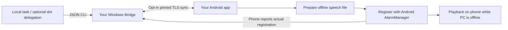

# MemoAlarm Bridge

**Private voice notes and spoken Android reminders that work after your PC goes offline.**

[한국어](README.ko.md) · [Install](docs/installation.md) · [How it works](docs/protocol.md) · [Verification and limits](docs/verification.md)

Write a note or schedule on Windows or Android. Connect your own devices when you choose. Android prepares speech ahead of time and registers the alarm with the OS. After the phone reports a future registration, the PC, network and AI do not need to be available at that time.

This is a **development preview**, not a verified device release. Android APKs build and JVM tests pass, but physical-phone audio, reboot, DND/OEM behavior and UI flows have not been exercised. Windows package checks pass; the latest Windows runtime tests were blocked by the development machine's Application Control policy. See the [measured verification report](docs/verification.md).

## What you can do

- Use either app on its own: text and voice notes, plus one-shot, daily and selected-weekday schedules.
- Prepare offline Android speech before an alarm; stop or snooze each occurrence independently.
- Pair with a one-use invitation and a checked certificate fingerprint. Keep your own data on your own devices.
- Review both versions when edits conflict. See pending sync, blocked preparation and the phone's actual reported schedule separately.
- Let a local task use the JSON CLI. Optionally open a saved ChatGPT conversation from a button; no automatic call or paid AI API is required.

Giving a repository URL to your dot does **not** automatically connect a cloud dot to a local MCP server. The implemented interface is the local CLI; account-specific MCP/tunnel connectivity remains unverified. [Dot integration guide](docs/dot-integration.md).

## Start with one phone alarm

1. Use a checked Windows ZIP or [build from source](docs/building.md). Extract it and open the executable to review local installation. Startup and phone access are optional.
2. Install the **development-only** Android APK after reviewing its source and signature label. The unsigned release APK needs deliberate signing and is not directly installable.
3. On the phone, choose an installed offline TTS voice and grant exact-alarm and notification permissions. Use **Test in one minute**, then check playback and Stop.
4. If you want sync, enable the PC connection at a reachable address, compare the fingerprint and paste the full ten-minute invitation into Android Setup.
5. Press **Sync now**, inspect each phone status, and test with the PC stopped and the phone offline. A PC save alone is always pending delivery.

No central account, hosted database, Firebase or separate AI API key is required. Voice notes are recordings; automatic transcription is not included. [Full setup and recovery](docs/installation.md).

## Current boundaries

Windows 10/11 x64 is the distribution target; Android API 31+ is the build target. Each rule prepares its next two future occurrences, with at most 50 active rules. Repeating rules keep a fixed IANA time zone. After reboot and before first unlock, only the saved finite window is available, using a generic tone; unlock to restore private speech and replenish it.

Alarm volume, Android's DND policy and an optional silent-mode preference apply. This app does not change those settings. Force-stop, revoked permissions, unavailable offline voices and OEM restrictions can prevent alarms. An offline phone can still ring until it receives a cancellation. [Support matrix](docs/support.md) · [Security model](docs/security.md).

## Build and contribute

The bridge is Go; the app is native Kotlin. There is no AI inference service in the runtime. Start with [building](docs/building.md), [protocol](docs/protocol.md), [contributing](CONTRIBUTING.md) and [security reporting](SECURITY.md). Reports from real Android devices are especially useful—include platform/model and reproducible steps, not private notes or recordings.

New code is [MIT licensed](LICENSE). Third-party components and the generated fallback tone are documented in [notices](THIRD_PARTY_NOTICES.md). ChatGPT/dots are optional external products; this project is independent of OpenAI.
